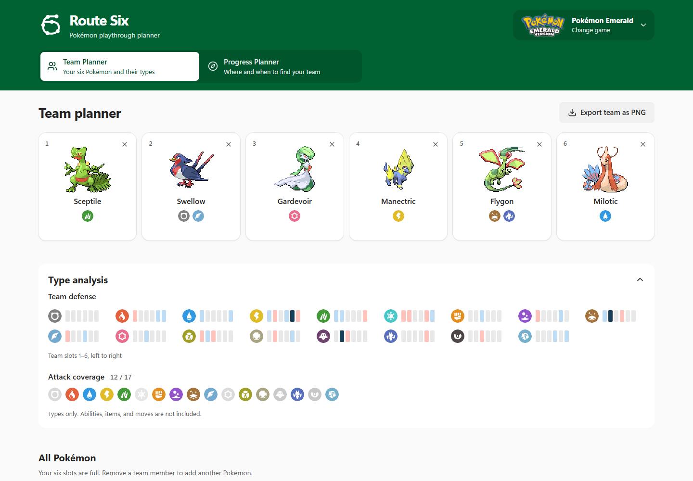
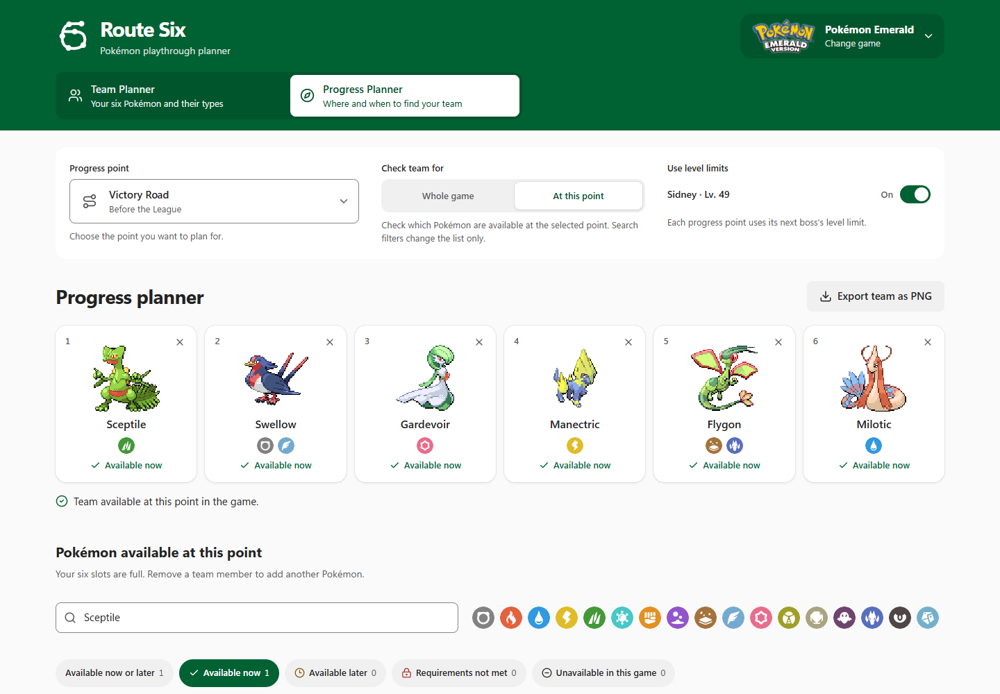

# Route Six

**Plan your next Pokémon team. Find out where and when to catch it.**

[Open Route Six](https://luisleineweber.github.io/route-six/) · [Supported games](#supported-games) · [Report a problem](https://github.com/luisleineweber/route-six/issues)

Route Six helps you build a team of six before your next playthrough.
Compare types, find Pokémon in your game and check which team members you
can get at each stage. Use it in your browser. No account or installation is needed.

The Full Game view uses that team as the goal for the Elite Four and Champion.
It shows earlier evolution stages and missing members before each Gym. Players
can select temporary members for each stage. This first layer checks each team
separately. See [Full Game scope](docs/full-game-planner.md) for its limits.

## Build a team you want to play with

Choose your game, then add up to six Pokémon. Swap team members and check
which attack types your team is weak to. Search by name, type or Pokédex number.

**Team Planner** helps you compare teams. **Progress Planner** helps you find
them in the game. Your team stays with you when you switch between the two.

## Know what you can get next

Choose your progress point to see which Pokémon are available now, which
come later and which need other conditions. Open a Pokémon's details for
locations and evolution steps. Turn on level limits to plan for the next boss.

## Start in three steps

1. **Choose your game.** Both planners support all 24 games listed below.
2. **Build your team.** Add your favourites and compare their types.
3. **Check your progress.** Find locations and requirements, then export your team as a PNG image.

You can use Route Six on a phone or a computer.

## Supported games

| Region | Games |
| --- | --- |
| Kanto | Red, Blue, Yellow, FireRed, LeafGreen |
| Johto | Gold, Silver, Crystal, HeartGold, SoulSilver |
| Hoenn | Ruby, Sapphire, Emerald, Omega Ruby, Alpha Sapphire |
| Sinnoh | Diamond, Pearl, Platinum |
| Unova | Black, White, Black 2, White 2 |
| Kalos | X, Y |

[Game coverage and source notes](docs/game-data-progress.md) explain the details and known limits.

**More games are planned.** We plan to add the remaining Pokémon games over
time. The table above shows what you can use today. New games will be added
after their encounter and progress data have been checked. No release dates
are set yet.

## Before you start

- **Reloading clears your plan.** Export a PNG if you want to keep a picture of your team. It is not an editable save.
- **The first progress check can take a while.** You can keep using the page while it works.
- **Route Six is a guide.** It does not read your game save or track your bag and completed events.
- Progress checks exclude player trades, transfers and external events. Type analysis does not include moves, held items or abilities.

## Help improve Route Six

Found a wrong location or a missing requirement? [Open an issue](https://github.com/luisleineweber/route-six/issues).
Include the game, your selected progress point and the Pokémon involved.
Screenshots help too.

For setup, tests and data changes, read the [development guide](docs/development.md).

## Credits and licence

Route Six is an unofficial fan project. Pokémon names and artwork belong
to their respective rights holders. Sprites come from [PokéAPI](https://github.com/PokeAPI/sprites);
type icons come from [partywhale](https://github.com/partywhale/pokemon-type-icons).

Original application code uses the [MIT licence](LICENSE).
See [licence scope and third-party notices](NOTICE.md) for the exclusions.
