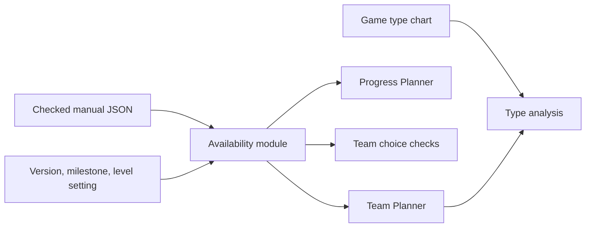

# Pokémon Playthrough Planner: MVP plan

Status: revised on 2026-10-26 from later project decisions. This revision takes
priority over earlier MVP choices wherever they conflict. See the
[decision history](mvp-decisions.md), [implementation checks](implementation-checks.md),
and game-specific coverage files.

## Current MVP: later decisions take priority

The MVP is now a multi-game planner. It supports the games present in the game
registry and their checked local data. Pokémon Emerald is the first complete
reference implementation; it is no longer the only supported game. Keep shared
Pokémon identity data consistent across games, and keep game-specific forms,
types, sources, and progress rules in each game's data.

The current catalogue has 24 games. Eleven games from Generations I–III support
both planners. Thirteen games from Generations IV–VI support Team Planner;
Platinum, Diamond, Pearl, X, and Y also support Progress Planner. The selector
shows each game's coverage level. The other eight games remain Team ready while
their Progress Planner data is under review.

The app has two distinct modes:

- **Team Planner:** a simple team builder. It shows the game catalogue and team
  type analysis. Do not put progress, availability, or level-limit controls in
  this mode.
- **Progress Planner:** the access guide. It uses a game-specific progress
  point and shows available Pokémon, their easiest useful source, and their
  evolution path.

Both modes use the same six team slots for the selected game. Keep the team
when the user changes modes. Clear it when the user changes games. Sort Pokémon
by regional Pokédex first, then National Pokédex, and show those groups as
separate sections. Keep Pokémon that are not available at the selected point
visible when the user plans for the whole game.

The progress selector uses the eight Gym battles and Victory Road where the
game has that milestone. Games without Victory Road use their eight Gym
milestones. Do not expose route visits and story events as separate selector
stages. Keep required route, story, item, and capability rules in the access
data so availability stays accurate at each selected stage.

Keep the level-limit switch separate from the planning target. It applies to
Progress Planner access checks and may be turned off. A team target of **Whole
game** allows future access in team checks; it does not change the visible
search filters. Search and type filters belong with the Pokémon list. Keep
search text and type filters when the target changes.

The visual direction is a clear, dark field guide with strong game-specific
header colours and white highlights. Keep controls and status text clear. Use
compact, legible Pokémon grids: nine per row in Team Planner and six per row in
Progress Planner. Keep all entries in one continuous page instead of splitting
the catalogue into pages. Keep the team overview visible while planning. Use a
fullscreen team strip with six compact 4:3 slots; show the Pokémon image and
type side by side, and keep empty slots visible. Use clear Gym labels, with the
Gym number and type where useful. Do not use a long, plain event list or nested
progress menus.

Use the game logos in the game selector. Group games by generation and sort
them in game order. Prefer English logos. Do not repeat a selected-state label
or add text that the logo and layout already make clear. Check logo contrast
against each game's background colour. Keep a useful footer with a GitHub link
and needed project information.

In the Team Planner catalogue, show the add control on hover at the card's
upper-right edge. Give clear feedback when a Pokémon is added. Put type markers
in the card's lower-right area. Keep the detail view available from the card,
but do not add a separate detail-file control. Use a visible remove action for a
selected Pokémon; do not add a separate replace action. Keep the type analysis
compact and combine weaknesses, resistances, and immunities in one graph when
that remains easy to read.

Keep visible acquisition details short and useful: the easiest relevant source,
its location and method, and a clear evolution sequence with levels or items.
Use only sources for the selected Pokémon, not inherited source lists from its
pre-evolutions. Keep finding methods such as grass and Surf identifiable with
their icons. For future access, show the actual route or area as well as any
remaining requirement. Avoid repeated sources, overlong technical explanations,
and vague failure text.

The team overview and Progress Planner can be exported as PNG. Make the export
readable at a glance. The team export shows the team and type effectiveness with
colour, with the export button aligned with its heading. Use the game logo and
type graphics to give the export character without adding a large title or
unneeded containers. Keep team cards the same height. The Progress export shows
the team, the easiest useful source, and a clear evolution sequence, with
pre-evolution images where useful. Put extra encounter locations in one section
below the team. Do not repeat the same extra-location block on each card. Show
encounter methods with their icons. Use clear text wrapping and enough width for
the source text. Do not include unnecessary warnings, vague "no valid source"
text, or a long list of extra locations.

Accessibility and responsive layout remain required. Every interface change
needs a before and after screenshot. Preserve keyboard access, visible focus,
status text, and narrow-screen support.

Pokémon detail views show the selected Pokémon's own acquisition paths and its
evolution line. Let the user open another evolution stage from that line. Show
required levels and items. Keep first-access text short. Avoid duplicate paths,
repeated close controls, and technical text that does not help a player act.
When a Pokémon becomes available later, include its actual location and the
remaining requirement. When the data shows an earlier available evolution, use
that earlier stage as the useful route to the planned Pokémon.

Keep catalogue error and team-conflict messages readable at the available page
width. Explain the cause in direct language. Do not rely on a small narrow text
column, unexplained symbols, or colour alone. Use type colours in the analysis
and exports, with text labels where players need to understand status.

The initial page may open directly in a planner. A separate home page was
discussed as an idea, but no decision made it a required MVP feature. Type
multi-select was also discussed as an option, not a confirmed default.

## Review: settled decisions and remaining work

The later project chats and current project rules already resolve the product
questions that were listed as open in an earlier review. No further product
decision is needed for those points.

### Decisions already settled

- **Supported games:** all eleven Generation I–III games support both planners.
  Of the thirteen Generation IV–VI games, all support Team Planner. Platinum,
  Diamond, Pearl, X, and Y also support Progress Planner. The game selector
  shows each game's coverage level. A registry entry alone does not mean its
  progress data is ready. See [adding reviewed game data](adding-games.md) and
  [Generation IV–VI status](generation-456-progress.md).
- **Progress stages:** Progress Planner uses Gym 1 through Gym 8, then Victory
  Road when that game has the milestone. It defaults to Victory Road when
  present, and otherwise Gym 8. It does not offer starter, story, League, or
  post-game checkpoints. Games without reviewed progress data remain Team
  Planner only until their data is complete.
- **Level limits:** the limit uses the next opponent's highest level. At the
  selected progress point, use that point's limit. For **Whole game**, evaluate
  each future source at its own progress point and limit. Turning limits off
  removes level checks only. Area, item, game-trade, and source rules still
  apply. The switch remains available for Whole game planning.
- **Unavailable and later access:** show supported game species from the game's
  profiles. Keep reviewed exclusions distinct from unfinished data. Player
  trades and external distribution events do not provide access. Whole game
  checks future milestones in the reviewed game data, including post-game
  sources where those records exist; the progress selector still ends at its
  last configured checkpoint.
- **Plan persistence:** keep the team and settings in memory while the app is
  open. Keep the team when the user changes planner mode. Clear the team when
  the user changes games. A reload starts a new plan; there are no accounts or
  saved player plans.

### Work still needed

- Complete Progress Planner data review for HeartGold, SoulSilver, Black,
  White, Black 2, White 2, Omega Ruby, and Alpha Sapphire. They are Team ready
  while that access data is under review.
- Keep each game's coverage status, source review, and automated checks in its
  game data and coverage notes. Mark a game Progress ready only after those
  checks pass.
- Update the historical Emerald implementation checks and HTML export so they
  do not read as the current multi-game acceptance list. The HTML page is now
  marked as a historical reference and links to this plan.
- Keep release checks aligned with the current scope: data check, tests, build,
  both planner modes for Ready games, game and mode switching, keyboard and
  narrow-screen access, PNG readability, and before/after screenshots for UI
  changes.

The product scope is settled. The remaining gaps are data coverage and keeping
the implementation checks current; they do not require another product choice.

## Historical Emerald MVP details

The sections below record the original Emerald implementation contract. Keep
their domain rules where they still fit the current product. Treat any claim that
Emerald is the only game, that the catalogue is limited to Generation III, or
that every route and story event must be a selectable progress stage as
superseded by the current MVP above.

## Goal and scope

Help a player plan up to six Pokémon for Pokémon Emerald. Show how to obtain
each Pokémon and whether the selected progress point permits it.

Support every route and story event. Include Gyms, the Pokémon League, optional
areas, and normal post-game progress. The complete route and event list is in
[Emerald coverage](emerald-coverage.md).

Maintain all data by hand. Show Pokémon from other versions as unavailable.
Limit the initial catalogue to species that exist in Generation III. This keeps
the catalogue relevant to Emerald; later-generation species are outside this MVP.

Use types for team analysis. Label the result as type analysis. Ability effects,
held-item effects, and learned moves do not form part of this calculation.

External distribution events need a clear unavailable reason. Do not assume the
player can obtain an event item. Ordinary gifts and story events remain included.

## Current user flow

```text
Open the project
└─ Open the local field guide
   ├─ Plan a six-member team
   └─ Check Pokémon access at the selected progress point
```

## User flows

```text
Open Team Planner
├─ Select game and version
│  └─ Emerald is the only supported version
├─ Select current progress
│  └─ Search routes and events, grouped by story section
├─ Select planning target
│  ├─ Whole game
│  │  └─ Keep later Pokémon in the plan; show the current availability status
│  └─ Current progress
│     └─ Highlight Pokémon that are available now; keep other entries visible
├─ Keep the level limit on, or turn it off
│  └─ Show the next Gym or League opponent and its highest level
├─ Search Pokémon and add up to six
│  ├─ Available now: show an acquisition path
│  ├─ Available later: show the first valid progress points
│  ├─ Blocked by a condition: show the condition and required action
│  └─ Unavailable in Emerald: show the reason
└─ Read team results
   ├─ Type weaknesses, resistances, immunities, and attack coverage
   ├─ Repeated types
   └─ Availability and choice warnings

Open Progress Planner
├─ Use the same version, progress point, and level setting
├─ Read Pokémon available now
│  ├─ Wild encounters and fixed encounters
│  ├─ Starters, gifts, eggs, fossils, and game trades
│  ├─ Breeding with an accessible and compatible parent pair
│  └─ Evolutions whose conditions can be met
├─ Show blocked and unavailable entries when requested
│  └─ Read why each entry is blocked
└─ Add a Pokémon to the same planned team
```

The two planners share settings and the same team. Changing progress does not
remove team members. It updates their status and the team warnings.

## Pages and components

| Page or component | Purpose |
| --- | --- |
| Team Planner | Six team slots, Pokémon search, and team analysis. |
| Progress Planner | Available Pokémon and their acquisition paths. |
| PlannerSettings | Game, version, progress, target, and level limit. |
| MilestonePicker | Searchable route and event list with section labels. |
| PokemonSearch | Name and type search; status and source filters. |
| PokemonCard | Name, types, status, source, and earliest progress. |
| AcquisitionDetails | All valid sources, evolution steps, and requirements. |
| TeamSlots | Add, replace, and remove Pokémon; enforce six slots. |
| TeamWarnings | Explain unavailable members and incompatible choices. |
| TypeAnalysis | Counts by attack type and offensive coverage. |

Use text with status colours. Controls need visible labels, keyboard access, and
visible focus. A level limit change must update the result summary. Do not use
colour or a lock icon as the only explanation. On narrow screens, show settings,
team slots, warnings, and analysis in that order.

Use a normal selectable list for progress first. A custom map is outside this MVP.

## Progress rules

Each route or story event has a milestone ID. Separate a location from its visits:
a route can have an initial visit and a later visit after Surf becomes possible.

Milestones form a dependency graph. `previousIds` lists mandatory prior milestones.
`displayOrder` controls the list order only. It does not prove access. Selecting a
milestone includes its mandatory ancestors. It does not imply that the player
visited every optional route shown earlier in the list.

Locations have access requirements. Sources have their own requirements too.
For example, reaching a route does not by itself permit its fishing encounters.
Fishing equipment, HM access, story gates, and item access must remain explicit.

The planner answers what a player *could obtain*. It does not track their exact
bag, current Pokémon levels, missed catches, or completed optional visits.

Each milestone names its next Gym or League opponent. The stored highest level
sets the recommended limit. Before and after a battle are separate milestones.
After the final League battle, there is no next League opponent. Show that no
recommended limit applies; do not invent a replacement value.

## Shared availability module

Both planners call one pure module with validated game data and a query.
The module returns a result for every catalogue entry, including unavailable ones.



1. Resolve the selected milestone and its mandatory ancestors.
2. Resolve accessible locations, item sources, and capabilities.
3. Seed paths from allowed Pokémon sources. Apply the level rule to source levels.
4. Follow evolution and breeding rules until no new valid paths appear.
5. Keep source IDs, parent proofs, minimum levels, choices, and resource uses in paths.
6. Check future milestones to find the first valid access points for blocked entries.
7. Return available, later, blocked, or unavailable status with clear reasons.

Use a finite set of useful witness paths. Keep alternatives when they change
choices, required resources, access points, or minimum level. Stop cycles; a
Pokémon cannot become available merely because a rule needs that same Pokémon.

A level-up evolution requires a level gain. Its minimum output level is the
greater of the rule's minimum level and the parent's minimum level plus one.
An item evolution keeps the parent's minimum level. Game trades must use their
actual level rule; do not assume every received Pokémon has a fixed level.

Evolution conditions include level, stone access, friendship, time, Beauty,
stat comparison, personality, and special Emerald conditions. Player trade
rules remain visible as blocked rules. They never make a Pokémon available.
Do not claim a condition is met unless the game data and rule evaluator prove it.

Available Pokémon remain available through evolution even when the final form
has no direct encounter. An unavailable base species does not unlock its family.
Turning the level limit off changes level checks only. It does not unlock areas,
items, game trades, player trades, or other-version Pokémon.

For each Pokémon, show the valid base source, the location, evolution steps,
requirements, and first access points. Do not show an arbitrary first encounter
if a different acquisition path is earlier or avoids a choice conflict.

## Team choice checks

Individual availability and team feasibility are different results.
Keep acquisition alternatives so the team check can find a compatible set of paths.

Check choice groups such as starter selection. Also check finite source uses and
finite items consumed by the selected paths. Try all useful path combinations for
the six slots before showing a conflict. A shared evolution ancestor alone is not
proof of a conflict. A repeatable source can supply more than one Pokémon.

Warn when no compatible path assignment exists. Explain the source, choice, or
resource that causes it. Do not erase team members. A future source can remove a
current-progress conflict; a whole-game result must therefore check future access.

Breeding parents and held items remain reusable. Combine proofs of repeated parent
use instead of counting each egg as a new use of a one-time starter. Two parents
must still be distinct Pokémon. A single finite source cannot supply both parents
when it provides only one Pokémon. Keep gender assignments and resource limits
consistent across the whole plan. A parent can breed before a later evolution or
game trade; the team check must find a valid order for those actions.

## Breeding rules

Include breeding when the Day Care, two compatible parents, and required held
items are accessible. Check actual possible genders for each acquisition path.
Do not use a species-wide gender list when a particular gift or trade fixes gender.
Keep reviewed gender transitions through evolutions and separately created products.
Parent access must be possible under the selected progress and level settings.

Use the selected game's Egg Groups and compatibility rules. Handle Ditto and
non-breeding species explicitly. The
[Emerald Day Care code](https://github.com/pret/pokeemerald/blob/master/src/daycare.c)
defines compatibility, offspring, and incense conditions.

Maintain offspring rules by hand in `breeding-rules.json`. Each rule names the
eligible family parents, possible offspring species, and required held item.
The module finds a compatible partner from accessible Pokémon profiles. Do not
enter every possible species pair. Each result must include a concrete parent
pair with valid acquisition proofs.

Keep ordinary egg gifts separate from breeding sources. For Emerald, use its
actual hatch level. Apply the level limit to both parent access and the hatched
Pokémon. Show parents, Day Care access, required items, and hatch level in details.
Inherited moves and breeding for battle stats remain outside the type-only MVP.

Breeding can permit several forms of one starter family. Each offspring keeps
the original starter choice. A breeding cycle with no accessible parents does
not unlock a species. Preserve these proofs when resolving later evolutions.

## Type analysis

Use Emerald's Pokémon type profiles and its type chart. Shared Pokémon identity
data contains names and Dex numbers; it does not impose modern types on old games.
For example, Emerald's Ralts profile is Psychic. See the
[Emerald species data](https://github.com/pret/pokeemerald/blob/master/src/data/pokemon/species_info.h).

For each attacking type, multiply its chart entries against both defending types.
Count values greater than 1 as weaknesses, values between 0 and 1 as resistances,
and 0 as immunities. Keep 2× and 4× weaknesses visible in Pokémon details.

For attack coverage, use each distinct team type as an attacking type. A defending
type is covered when at least one team type deals more than 1× damage to it.
The denominator is the selected game's active type count. It is not fixed at 18.
Show repeated types separately. Do not imply that a Pokémon has learned a move.

## Data files and checks

The [data contract](data-contract.md) specifies all files and references.
The [TypeScript contract](data-types.md) defines input and result types.
The [JSON Schema](schema/planner-data.schema.json) checks the assembled dataset.

Write and check data in story sections. Start with the route to the first Gym.
Then add each section through the League and normal post-game areas. Each complete
section must work before the next one is added. The MVP is complete only when the
agreed full route and event coverage is present.

Keep a reference and review date for each record. Check the original game and
its source data. The [Emerald decompilation](https://github.com/pret/pokeemerald)
is a reference for manual review, not an automated import. Use a recorded revision
when checking data. Correct errors in the maintained JSON files.

Validate JSON shape first. Then check IDs, graph cycles, references, type-chart
dimensions, version types, source levels, choice limits, and catalogue coverage.
Missing data is a data error. It must not silently become an unavailable Pokémon.

## Implementation anchors

These paths contain the application modules.

| Module | Small public interface | Path |
| --- | --- | --- |
| Data validation | `validateDataset(input)` | `src/data/validate-dataset.ts` |
| Availability | `getAvailability(data, query)` | `src/domain/availability/index.ts` |
| Team feasibility | `checkTeam(snapshot, team, target)` | `src/domain/team/check-team.ts` |
| Type analysis | `analyzeTypes(data, team)` | `src/domain/team/analyze-types.ts` |
| Planner state | Settings and six selected IDs | `src/features/planner/state.ts` |
| Team view | Render team and analysis | `src/App.tsx`, `src/features/team/` |
| Progress view | Render availability results | `src/features/progress/PokemonSearch.tsx` |

Keep graph traversal, requirements, and path selection inside the availability
module. Pages render results; they do not duplicate access or evolution rules.
The state layer owns user changes. Domain modules have no UI or storage effects.

The stack is React, TypeScript, and Vite. Use local state for this small
application. Use Ajv's Draft 2020-12 support with `ajv-formats` for data checks,
and Vitest for domain tests. Package versions are recorded in `package.json`
and `package-lock.json`.
See [React state guidance](https://react.dev/learn/managing-state),
[Vite setup](https://vite.dev/guide/), [Ajv schema support](https://ajv.js.org/json-schema.html#draft-2020-12),
and [format checks](https://ajv.js.org/guide/formats.html).

## Build order and completion checks

| Step | Work | Completion check |
| --- | --- | --- |
| 1 | Check the route and event inventory. | Every route and event has a named record owner and story section. |
| 2 | Set up the application and data validator. | Invalid records fail with file and record IDs. |
| 3 | Enter one complete early-game data section. | References, levels, gates, and chart entries pass review. |
| 4 | Build the availability module. | Direct sources, evolution, breeding, level limits, and exclusions pass focused tests. |
| 5 | Build Progress Planner. | The first section shows sources and blocked reasons from the shared module. |
| 6 | Build Team Planner and choice checks. | Six slots, both targets, source alternatives, and conflict warnings work. |
| 7 | Add type analysis. | Dual types, immunities, repeated types, and coverage pass known examples. |
| 8 | Enter and check all remaining Emerald sections. | Every route, story event, and catalogue entry has a reviewed outcome. |
| 9 | Check both planners together. | Settings stay shared; progress changes update warnings without losing the team. |

Core regression cases: a route unlocked before a fishing method; a multi-stage
evolution crossing the level limit; a level-up needed after a high-level capture;
an item evolution before stone access; a game trade before its offered Pokémon;
a player-trade-only form; an other-version species; an exclusive starter team;
an alternative source that removes a conflict; and a Pokémon retained from an
earlier acquisition point. Add breeding cases for Day Care access, compatible and
incompatible parents, fixed-gender gifts, Ditto pairs, required incense, repeated
eggs from one parent pair, a starter family with several forms, and a breeding
cycle with no initial parent source. Test parent and hatch levels at the limit.

## Design choices

Use one availability module, explicit results, dependency-based milestones,
version-correct type profiles, and manual data with review references.
Do not duplicate rules across pages or use badge count as the only progress value.
Do not add an import pipeline, a backend, accounts, move databases, or a world map.

The product choices, route/event list, and manual data set are implemented.
The completion checks are recorded in [implementation checks](implementation-checks.md).
